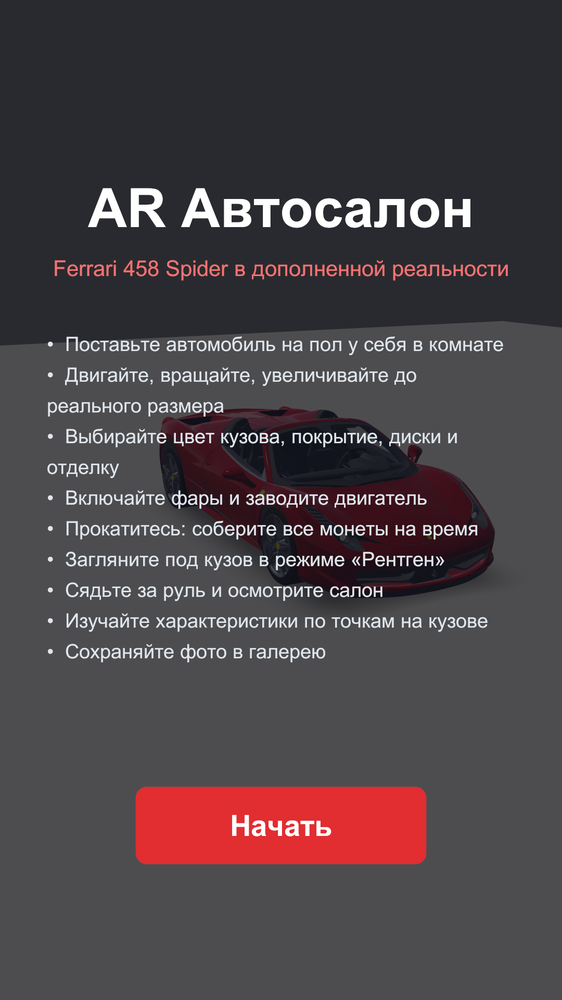
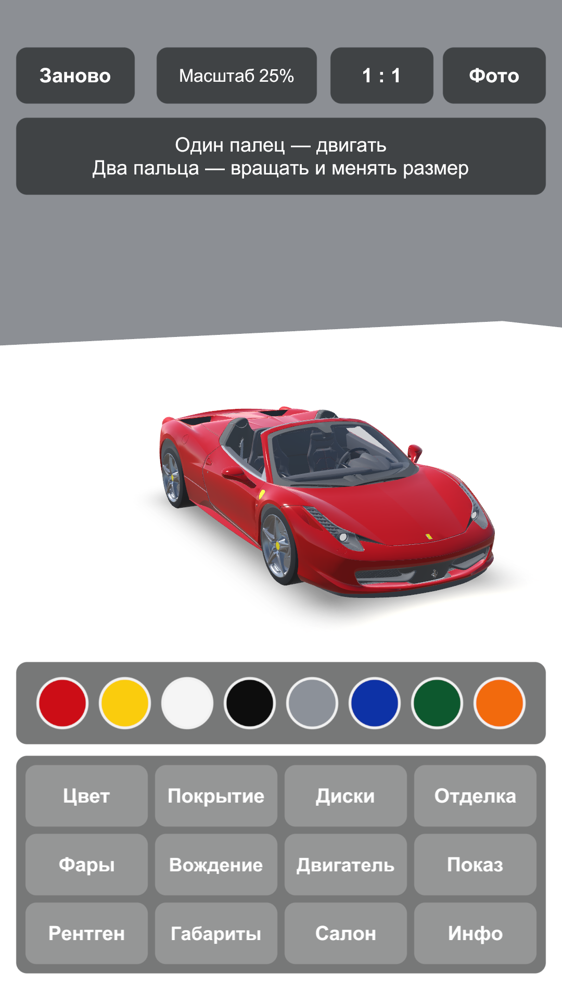
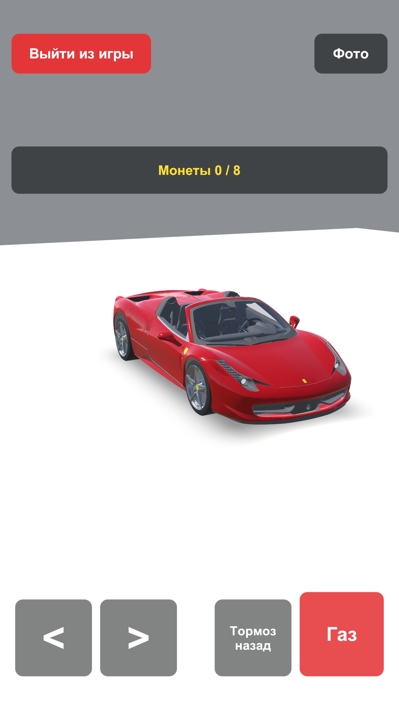
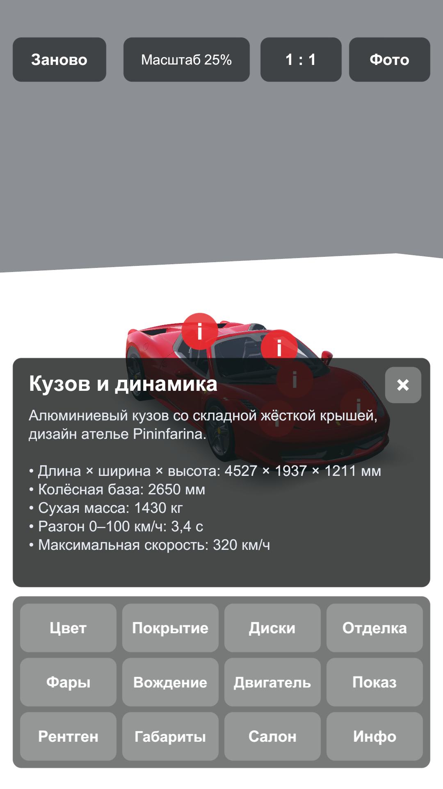
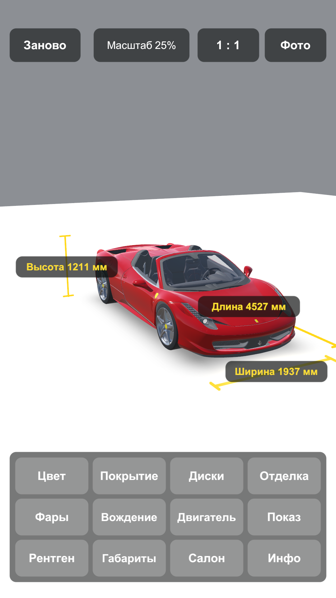
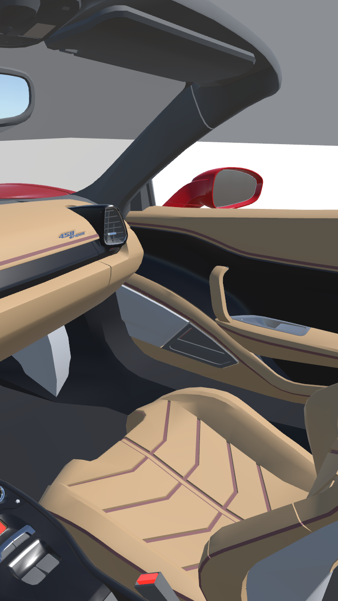
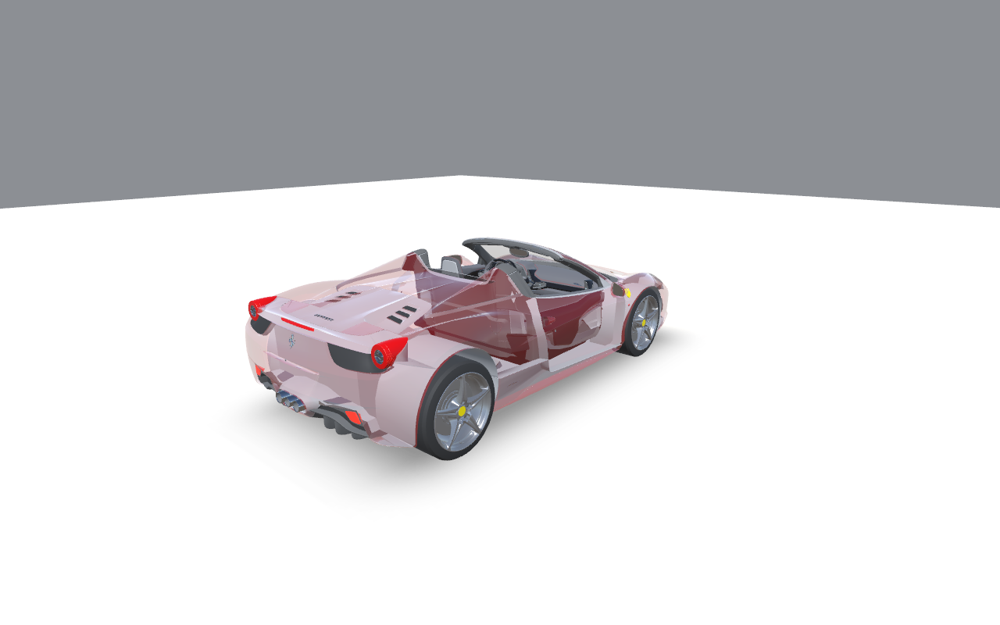
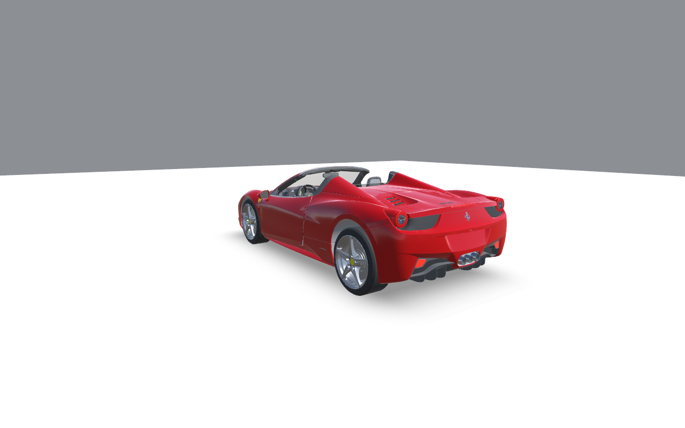

# AR Автосалон

Мобильное приложение дополненной реальности для Android: на пол в комнате ставится 3D-модель автомобиля Ferrari 458 Spider, её можно осмотреть со всех сторон, перекрасить, сесть за руль и даже прокатиться.

Учебный проект по курсу дополненной реальности. Сделан на **Unity 6**, **AR Foundation** и **Google ARCore**.

  
  
  

> Скриншоты сделаны в редакторе Unity на сером фоне. На телефоне вместо фона — изображение с камеры.

## Скачать

Готовый файл для установки — **[ARCar.apk в разделе Releases](../../releases/latest)**.

## Возможности

| | Функция | Что делает |
|---|---|---|
| 📍 | **Размещение на полу** | Камера находит горизонтальную поверхность, прицел показывает, куда встанет машина, касание — ставит её |
| ✋ | **Жесты** | Один палец — перемещение, два пальца — поворот и масштаб; кнопка «1 : 1» включает реальный размер |
| 🎨 | **Цвет** | 8 цветов кузова, смена цвета плавная |
| ✨ | **Покрытие** | Глянец, матовый, металлик |
| 🛞 | **Диски** | Серебро, чёрные, золото, в цвет кузова |
| 🪑 | **Отделка** | 5 цветов кожи салона |
| 💡 | **Фары** | Включаются передние и задние огни, на полу появляется пятно света |
| 🔊 | **Двигатель** | Звук мотора с «перегазовкой» при запуске |
| 🔄 | **Показ** | Машина медленно вращается, как на подиуме |
| 🩻 | **Рентген** | Кузов становится полупрозрачным, виден салон |
| 📏 | **Габариты** | Линии длины, ширины и высоты с размерами в миллиметрах |
| 🚗 | **Салон** | Машина встаёт в реальном размере, а вы — на место водителя |
| ℹ️ | **Инфо** | Точки на кузове с карточками характеристик (двигатель, колёса, салон, фары, кузов) |
| 🏁 | **Вождение** | Мини-игра: соберите все монеты на полу за минимальное время |
| 📷 | **Фото** | Снимок без интерфейса сохраняется в галерею (папка `Pictures/ARCar`) |

Яркость виртуального освещения подстраивается под реальное освещение комнаты, под машиной есть мягкая тень.

  
  
  

  
  

## Требования к телефону

- Android 10 или новее
- Поддержка ARCore — проверить свою модель можно в [официальном списке Google](https://developers.google.com/ar/devices)
- Установленное приложение «Сервисы Google Play для AR» (обычно ставится само при первом запуске)

## Установка на телефон

1. Скачайте `ARCar.apk` из [Releases](../../releases/latest) прямо на телефон.
2. Откройте файл и разрешите установку из этого источника, если Android попросит.
3. Запустите **AR Car** и разрешите доступ к камере.

## Как пользоваться

1. Нажмите **«Начать»** и медленно поводите телефоном, наведя камеру на пол.
2. Когда появится белый прицел, коснитесь экрана — машина появится на полу.
3. Настраивайте машину кнопками нижней панели.
4. **«Заново»** — убрать машину и поставить в другом месте.

**Вождение:** держите **«Газ»**, рулите кнопками **«<»** и **«>»**, кнопка **«Тормоз / назад»** тормозит, а затем включает задний ход. Время начинает идти с первого движения, лучший результат сохраняется.

## Открыть проект в Unity

1. Установите **Unity 6000.6.6f1** через Unity Hub с модулем **Android Build Support** (вместе с Android SDK & NDK и OpenJDK).
2. Скачайте репозиторий: **Code → Download ZIP** и распакуйте, или `git clone`.
3. В Unity Hub нажмите **Add → Add project from disk** и выберите папку проекта.
   Путь к папке лучше делать коротким (например, `C:\Projects\ARCar`): на Windows Unity не работает с путями длиннее 260 символов.
4. При первом открытии Unity сама скачает нужные пакеты — это займёт несколько минут.
5. Откройте сцену `Assets/Scenes/ARCar.unity`.

### Сборка APK

1. **File → Build Profiles → Android → Switch Platform** (если платформа ещё не Android).
2. Подключите телефон с включённой отладкой по USB и нажмите **Build And Run**,
   либо **Build**, чтобы просто получить APK-файл.

Все настройки Android (IL2CPP, ARM64, минимальный Android 10, OpenGL ES 3, портретная ориентация) и включение ARCore уже сохранены в проекте.

### Пересборка сцены

Сцена, префабы, материалы, текстуры и интерфейс не собираются вручную — их создаёт скрипт `Assets/Editor/ARCarSetup.cs`. Чтобы пересоздать всё с нуля, выберите в меню Unity **AR Car → Пересобрать сцену**.

## Как это устроено

| Файл | За что отвечает |
|---|---|
| `Assets/Scripts/ARPlacementController.cs` | Поиск пола, прицел, установка машины, жесты, анимация появления, режим «Показ», вид из салона |
| `Assets/Scripts/CarController.cs` | Цвет и покрытие кузова, диски, отделка, фары, вращение колёс и руля, «Рентген», габариты |
| `Assets/Scripts/AppUI.cs` | Весь интерфейс: стартовый экран, подсказки, панели, информационные точки, фото в галерею |
| `Assets/Scripts/DriveGame.cs` | Мини-игра «Вождение»: управление, монеты, таймер, рекорд |
| `Assets/Scripts/EngineSound.cs` | Звук двигателя, синтезированный кодом (без аудиофайлов) |
| `Assets/Scripts/ARLightEstimator.cs` | Подстройка виртуального света под освещение комнаты |
| `Assets/Scripts/HoldButton.cs` | Кнопки, которые работают, пока их удерживают (газ, тормоз, руль) |
| `Assets/Editor/ARCarSetup.cs` | Сборщик проекта: настройки Android и ARCore, материалы, префаб машины, сцена и интерфейс |
| `Assets/Shaders/` | Простые шейдеры для тени, прицела и света фар |
| `Assets/Models/ferrari.glb` | 3D-модель автомобиля |

**Основные технологии:**

- **AR Foundation** — `ARPlaneManager` находит плоскости, `ARRaycastManager` определяет точку на полу под прицелом и под пальцем, `ARCameraManager` выдаёт оценку освещённости кадра.
- **ARCore XR Plugin** — реализация AR для Android.
- **Input System** (Enhanced Touch) — мультитач-жесты.
- **glTFast + Draco** — импорт сжатой модели в формате glTF (`.glb`).
- **Вождение** — упрощённая «велосипедная» модель автомобиля: угол поворота машины зависит от скорости и угла передних колёс.

**Версии пакетов:** AR Foundation 6.6.2, ARCore XR Plugin 6.6.2, XR Plugin Management 4.7.0, Input System 1.20.0, glTFast 6.21.0, Draco 5.6.0.

## Авторы и лицензии

- 3D-модель автомобиля: «Ferrari 458 Italia», автор **vicent091036**, лицензия [CC BY 4.0](https://creativecommons.org/licenses/by/4.0/). Файл взят из примеров [three.js](https://github.com/mrdoob/three.js/tree/dev/examples/models/gltf).
- Ferrari — товарный знак Ferrari S.p.A. Проект учебный, некоммерческий и с компанией Ferrari не связан.
- Текстуры интерфейса, шейдеры и звук двигателя созданы программно в рамках проекта.
